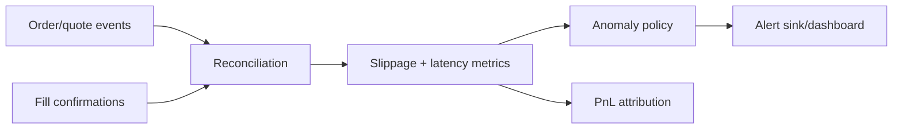

# Post-Trade Execution Quality & Risk Monitoring System

A venue-neutral monitoring core that reconciles quoted and executed prices, computes realized slippage, latency, gas, failed fills, and exposes deterministic anomaly alerts and PnL attribution.

## Architecture


## Workflow
1. Ingest quote and fill records with event timestamps.
2. Reconcile by order ID and venue.
3. Compute realized slippage, latency, gas, and status.
4. Apply configurable limits and emit alerts.
5. Produce an aggregate summary for post-trade review.

## Design rationale
Metrics are computed from immutable fill records rather than mutable dashboard state, which makes incident investigation repeatable. Alert thresholds are configuration, not hard-coded business logic.

## Run
```bash
pip install -e .
python -m post_trade.cli
pytest -q
```

## Limitations
This repository provides the monitoring core; production adapters must add durable storage, idempotency, authentication, and venue-specific reconciliation rules.
