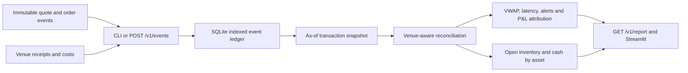
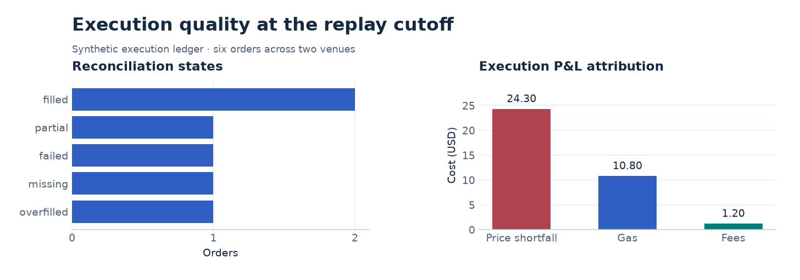

# Post-Trade Execution Quality & Risk Monitoring System

Ingest order and fill events into a durable SQLite ledger, replay reconciliation at any cutoff, and explain execution results by venue, route and asset. FastAPI exposes the ledger and Streamlit provides the interactive report.

## Run locally

Requires Python 3.11 or later.

```bash
python -m pip install -e '.[dashboard,test]'
post_trade_execution_monitor --db reports/execution.sqlite3 --seed-demo --output reports/execution.json
post_trade_execution_monitor --db reports/execution.sqlite3 \
  --as-of 2026-04-24T12:00:00.500Z --output reports/early.json
python -m pytest -q
```

In separate terminals, run the API (default database `reports/execution.sqlite3`) and dashboard. Set `EXECUTION_API=http://127.0.0.1:8000` for the dashboard to display the API ledger by default.

```bash
uvicorn post_trade.api:app
streamlit run src/post_trade/dashboard.py
```

The container setup uses the same API and a persistent ledger volume.

```bash
docker compose up --build --detach --wait
docker compose exec api post_trade_execution_monitor --db /data/execution.sqlite3 --seed-demo
```

Open `http://127.0.0.1:8501` for the dashboard and `http://127.0.0.1:8000/docs` for the OpenAPI console.

## Architecture



| Module | Responsibility |
|---|---|
| `events.py` | Enforces timezone-aware UTC event time, stable keys, side, and valid fill status and amounts. |
| `storage.py` | Persists batches atomically. A repeated payload is idempotent. Identity reuse with changed data returns a conflict and rolls back the batch. |
| `execution.py` | Repairs order state from qualifying receipts at the cutoff and computes signed execution and inventory metrics. |
| `api.py` and `dashboard.py` | Accept event batches, serve replay data, and let operators adjust thresholds, compare routes, inspect alerts and export JSON. |

## Input and API

An import body contains `orders` and `fills`. An order declares `venue`, `order_id`, `symbol`, `route`, `side`, `quantity`, `quoted_price_usd` and `sent_at`. A receipt supplies `venue`, `order_id`, `fill_id`, `filled_at`, `status`, `quantity`, `executed_price_usd`, `fee_usd` and `gas_usd`. A failed receipt has zero quantity, null execution price and any incurred costs. Order IDs are scoped to the venue. Multiple distinct successful receipts can form a legitimate partial or complete fill.

```bash
python -c "from post_trade.fixtures import demo_batch; print(demo_batch().model_dump_json(indent=2))" \
  > reports/events.json
curl --fail -H 'Content-Type: application/json' \
  --data-binary @reports/events.json http://127.0.0.1:8000/v1/events
curl --fail 'http://127.0.0.1:8000/v1/report?slippage_bps=40&latency_ms=1000'
```

## Reconciliation and measurement

- Recognizes pending, missing, filled, partial, overfilled and failed orders. Orphan and pre-order receipts become alerts with visible unlinked costs.
- Uses quantity-weighted fill prices and side-adjusted slippage. Adverse slippage is positive; price improvement contributes positively to execution P&L.
- Computes execution P&L versus the recorded quote after executed fees and gas. Signed inventory and net cash are reported separately, by symbol.
- Reports venue and route state counts, P95 latency, risk alerts and notional-weighted realized slippage. A configurable timeout controls the transition to a missing-fill alert.
- Uses event timestamps for as-of reconstruction. Ingest with venue/OMS-normalized events. The HTTP application is designed for local or private-network operation.

## Reproduced demo results

The synthetic ledger contains six orders. At the last captured event it shows two fills and one each of partial, failed, missing and overfilled. Attributed execution P&L is −$36.30, including $10.80 in gas and $1.20 in fees.


